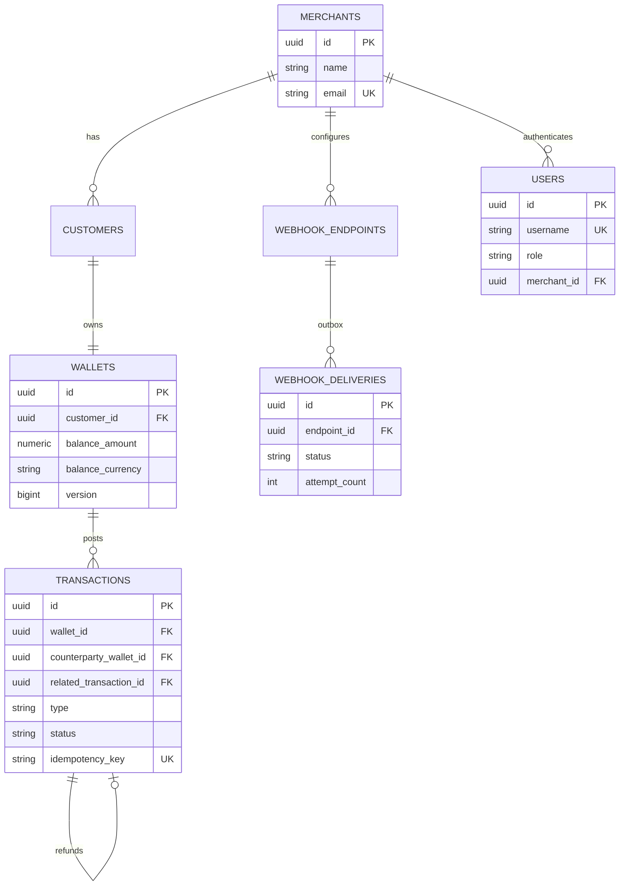

# PayLedger

PayLedger is a public portfolio project: a payments and wallet API built with **Java 21**, **Spring Boot 3** and **Spring Data JPA**.

It is aimed at recruiters and hiring managers who want evidence of solid backend design in a payments-flavoured domain — auditing, optimistic locking, embeddable money, Specifications, transactional outbox webhooks, JWT security, caching and metrics — rather than a claim of production traffic.

Milestones 1–5 are implemented so the owner can study a complete solution over four weeks. Start with [docs/STUDY_GUIDE.md](docs/STUDY_GUIDE.md).

## Features

- Merchant → Customer → Wallet domain with ledger transactions (`TRANSFER`, `CREDIT`, `DEBIT`, `REFUND`)
- `Money` as a JPA `@Embeddable`; shared auditable base entity; Wallet `@Version`
- Idempotent transfers and refunds (unique `idempotency_key`)
- Reconciliation report over ledger aggregates
- Transactional webhook outbox with signed HTTP delivery, retry/dead-letter, admin redrive
- Optional Kafka fan-out behind Spring profile `kafka` (off by default)
- Spring Security + JWT (`MERCHANT` / `ADMIN`) with merchant-scoped access checks
- Redis caching for merchant balance aggregates (profile `redis`); Micrometer + Prometheus
- Flyway migrations, Actuator, springdoc OpenAPI
- Testcontainers coverage across milestones; GitHub Actions `mvn verify`

## Architecture

```
Client (+ JWT)
  │
  ▼
REST controllers  ──►  services (@Transactional)  ──►  Spring Data repositories
                              │
                              ├── outbox → webhook_deliveries → HTTP dispatcher
                              ├── optional Kafka publisher (profile kafka)
                              └── cache eviction → Redis / simple cache
                              ▼
                     JPA entities + Flyway / PostgreSQL
```

## Domain (ER)



## Why these JPA choices

**Auditing** — timestamps on a `@MappedSuperclass` keep every table consistent.  
**`@Version` on Wallet** — concurrent balance updates fail instead of double-spending; see the concurrency test.  
**`Money` embeddable** — amount and currency travel together; `@AttributeOverride` maps balance vs transaction columns.  
**N+1 avoidance** — associations are `LAZY`; wallet reads and transaction search use entity graphs / fetch joins; `open-in-view` is `false`.  
**Specifications** — filtered transaction search stays composable without an explosion of repository method names.

## API (quick reference)

| Method | Path | Notes |
|--------|------|-------|
| `POST` | `/api/v1/auth/login` | JWT login (public) |
| `POST` | `/api/v1/wallets` | Provision wallet |
| `GET`  | `/api/v1/wallets/{id}` | Fetch wallet |
| `GET`  | `/api/v1/merchants/{id}/balance` | Cached JPQL sum |
| `POST` | `/api/v1/transfers` | Idempotent transfer |
| `POST` | `/api/v1/refunds` | Idempotent refund |
| `GET`  | `/api/v1/transactions` | Spec search |
| `GET`  | `/api/v1/reports/reconciliation` | Merchant report |
| `POST` | `/api/v1/webhooks/endpoints` | Register webhook |
| `GET`  | `/api/v1/admin/webhooks/dead-letters` | Admin only |
| `POST` | `/api/v1/admin/webhooks/deliveries/{id}/retry` | Admin only |

Interactive docs: [http://localhost:8080/swagger-ui.html](http://localhost:8080/swagger-ui.html)  
Health: [http://localhost:8080/actuator/health](http://localhost:8080/actuator/health)  
Prometheus: [http://localhost:8080/actuator/prometheus](http://localhost:8080/actuator/prometheus)

### Demo users (local only)

| User | Password | Role |
|------|----------|------|
| `admin` | `admin-change-me` | ADMIN |
| `merchant` | `merchant-change-me` | MERCHANT |

```bash
curl -s -X POST http://localhost:8080/api/v1/auth/login \
  -H 'Content-Type: application/json' \
  -d '{"username":"admin","password":"admin-change-me"}'
```

Pass the token as `Authorization: Bearer <accessToken>` on protected routes.

## How to run

### Prerequisites

- Java 21+, Maven 3.9+, Docker

### Tests

```bash
mvn verify
```

### Compose (Postgres + Redis + app)

```bash
docker compose up --build
```

App: `8080`. Profiles: `redis` for the app service.

### App only (DB via Compose)

```bash
docker compose up -d db redis
SPRING_PROFILES_ACTIVE=redis REDIS_HOST=localhost mvn spring-boot:run
```

### Optional Kafka profile

```bash
SPRING_PROFILES_ACTIVE=redis,kafka KAFKA_BOOTSTRAP_SERVERS=localhost:9092 mvn spring-boot:run
```

## Roadmap status

| Milestone | Status |
|-----------|--------|
| 1 Core ledger / transfers / JPA patterns | Done |
| 2 Refunds + reconciliation | Done |
| 3 Webhooks outbox (+ optional Kafka) | Done |
| 4 JWT security (merchant/admin) | Done |
| 5 Redis, Micrometer, deploy docs | Done |

Study plan: [docs/STUDY_GUIDE.md](docs/STUDY_GUIDE.md)  
Implementation map: [docs/BUILD_PLAN.md](docs/BUILD_PLAN.md)  
Deploy notes: [docs/DEPLOY.md](docs/DEPLOY.md)

## Licence

MIT — see [LICENSE](LICENSE).
